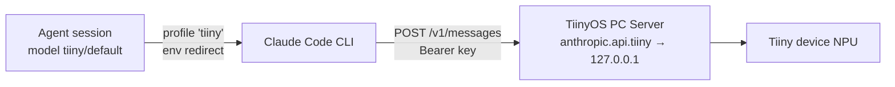

# Tiiny as a Provider for the Claude Agent SDK

> **Load when**: working on the Tiiny integration, `tiiny/*` model routing, the shared local-provider profile, or the Settings ▸ Tiiny tab.
> **Skip when**: changes don't touch model providers or `AgentConfig.model`.

**Added**: 2026-11-06 (experimental, behind `--experimental`)
**Status**: Working ✓ — unit-tested, `scripts/tiiny-smoke.sh` passed (raw endpoint, text, tool use), and a dashboard agent run succeeded on a real device (2026-11-06). Whether `/v1/models` lists models on the Anthropic endpoint is still unverified.

## What Tiiny is

A Tiiny device runs models on a local NPU. The **TiinyOS PC Server** on the user's computer exposes them through Anthropic-, OpenAI- and Ollama-compatible endpoints. The `*.api.tiiny` hostnames resolve to `127.0.0.1`, so the dashboard must run on the same computer as TiinyOS. The URLs are plain `http://`. Source spec: `TIINY_HARNESS_INTEGRATION.md` (repo root).

## How it works

Tiiny is a **profile of the Claude runtime**, like Ollama, not a separate runtime like Kimi. The SDK is pointed at `http://anthropic.api.tiiny` with environment variables (`profiles.build_tiiny_env`):

| Variable | Value | Why |
|---|---|---|
| `ANTHROPIC_BASE_URL` | `tiiny_base_url` (default `http://anthropic.api.tiiny`) | Routes all calls to the device |
| `ANTHROPIC_AUTH_TOKEN` | the API key | The CLI sends it as `Authorization: Bearer`, which Tiiny accepts. `x-api-key` is unverified, so it is not used. |
| `ANTHROPIC_API_KEY` | `""` | Stops a real Anthropic key from being used |
| `ANTHROPIC_MODEL`, `ANTHROPIC_DEFAULT_{OPUS,SONNET,HAIKU}_MODEL`, `ANTHROPIC_SMALL_FAST_MODEL` | the bare model ID | The device serves one model. Without these, the CLI's background Haiku-tier calls fail. |
| `API_TIMEOUT_MS` | `600000` | NPU inference and the first call after a model load are slow |
| `CLAUDE_CODE_DISABLE_NONESSENTIAL_TRAFFIC` | `1` | No telemetry or update calls during a local run |

### Model IDs

- Dashboard IDs are namespaced: `tiiny/<Model ID>`. `tiiny/default` routes to whatever model is loaded in TiinyOS and is always offered.
- The prefix keeps Tiiny IDs from matching `is_ollama_model`, which treats any ID that is not `claude-*` or `kimi-*` as Ollama. Bare `default` would otherwise go to Ollama.
- `profiles.sdk_model_id()` strips the prefix before the ID reaches the SDK. It is applied in both `session.py` and `review_agent.py`.

### The shared local profile

`resolve_profile(local_env, model=…)` returns the lean local profile for both Ollama and Tiiny (`AgentProfile.local=True`; `name` is `"tiiny"` for `tiiny/*` models and `"ollama"` otherwise). Shared settings:

- thinking disabled
- `setting_sources=("local",)`
- `bypassPermissions`
- no graphify, external MCP, plugins or Chrome
- the "be decisive" lifecycle addendum

The rationale is in `profiles.resolve_profile` and in project-plan Decisions. Thinking is also off for Tiiny: the smoke test did not show unsigned-thinking errors, but small local models gain little from thinking, and the replay crash Ollama had is not worth the risk.

`load_claude_md` is per provider: `tiiny_load_claude_md` for Tiiny and `ollama_load_claude_md` for Ollama (`profiles.load_claude_md_for`).

Auto-review works on Tiiny: `workflow_service._run_auto_review` passes `resolve_local_env(...)` to `run_auto_review`, which uses the same profile.

## API key

- It is **never stored in the DB**. `profiles.get_tiiny_api_key()` reads `$TIINY_API_KEY` first. On macOS it falls back to the Keychain entry with service `tiiny-api-key`:
  `security add-generic-password -s tiiny-api-key -a "$USER" -w`
- The Keychain fallback is what makes the GUI wrapper work, because a GUI app does not inherit shell env vars.
- Quotes and whitespace are stripped.
- The env dict holds the key, so `session.py` logs it only through `profiles.redact_env`. Never log a local env raw.
- If no key is found, `resolve_tiiny_env` still returns an env with an empty token. The run then fails with a clear 401 instead of silently going to Anthropic with a `tiiny/…` model ID.

## Config and UI

- **Migration 033** adds three `agent_config` columns: `tiiny_enabled` (default 0), `tiiny_base_url` (default `http://anthropic.api.tiiny`) and `tiiny_load_claude_md` (default 0). They are written by `PUT /api/config`.
- **Settings ▸ Tiiny** tab (`dialog.settings.tab-tiiny` / `panel-tiiny`, experimental only) holds:
  - the enable toggle
  - the base URL
  - key status (found / not found, never the value)
  - the load-CLAUDE.md toggle
  - a model list with **Refresh** (`GET /api/tiiny/models`)
  - **Test connection** (`POST /api/tiiny/test`, which sends "Reply with the word OK" and shows the reply)
- `GET /api/tiiny/models` always returns `tiiny/default`, then any IDs from `GET {base}/v1/models`. Whether the Anthropic endpoint lists models has **not** been verified; a 404 there is treated as "no listing", not as an error.
- **Model dropdowns**: a "Tiiny Models" optgroup (`DialogUtils.populateTiinyOptions`).
- **Cards**: a "Tiiny" provider badge (`provider-badge-tiiny`) and the model badge (`DialogUtils._isLocalModel`).

## Errors

`profiles.tiiny_error_hint(status, text)` turns a failure into a clear message. It is appended to the agent's error in `session.py` and used by the test route.

| Failure | Message |
|---|---|
| 401 | API key missing or wrong (where to set it) |
| 404 | wrong model ID, or no model loaded in TiinyOS |
| 502 | device still starting, retry in a few minutes (also classed as transient by `WorkflowService._TRANSIENT_API_STATUSES`) |
| connection refused / DNS failure | Tiiny not reachable: is TiinyOS running on this computer? |

## Smoke test

`scripts/tiiny-smoke.sh [model-id]` runs the acceptance tests from the spec with the plain `claude` CLI, using the same env as the profile:

1. raw `curl` to `/v1/messages`
2. a text reply
3. tool use: `hello.txt` must exist on disk with `hi`

It reads the key from the same places as the dashboard.

## Known gaps

- The cost shown for Tiiny runs is fake: the SDK prices tokens at Anthropic rates. Ollama has the same issue.
- The OpenAI and Ollama endpoints on the device are not used.
- A dashboard in Docker, WSL, a VM or on another machine cannot resolve `*.api.tiiny`. See §7 of the spec.

---

**See also**: [OLLAMA_PROVIDER](OLLAMA_PROVIDER.md) (the other local profile and the origin of the lean settings), [ARCHITECTURE](ARCHITECTURE.md) (`SessionService`, agent runtime).
