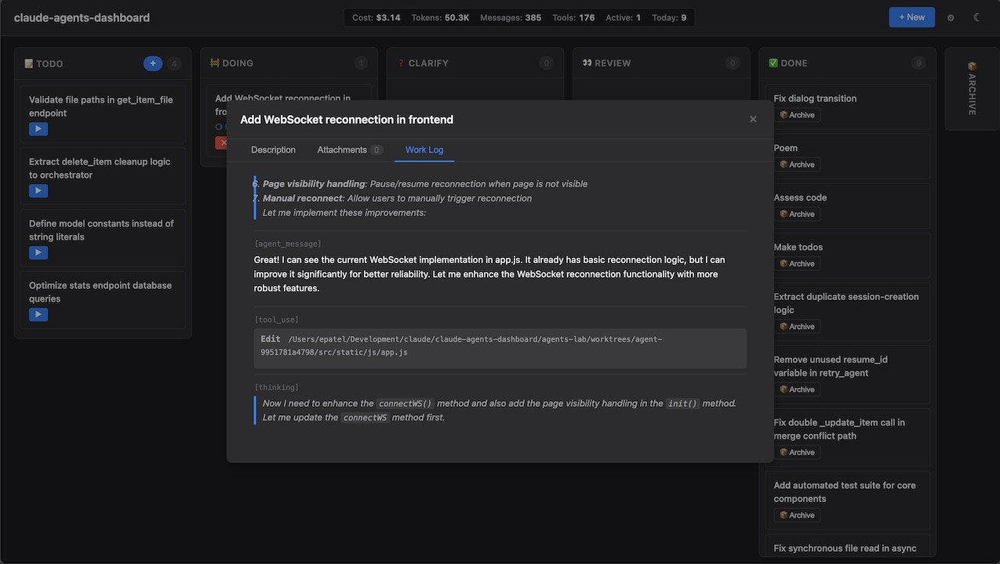
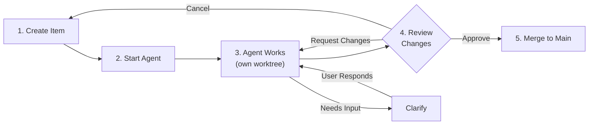
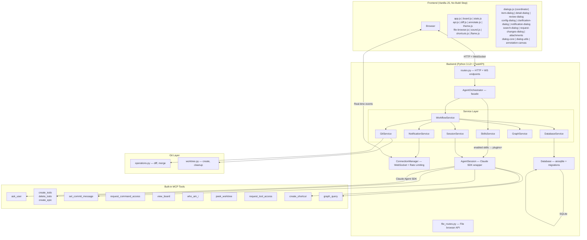
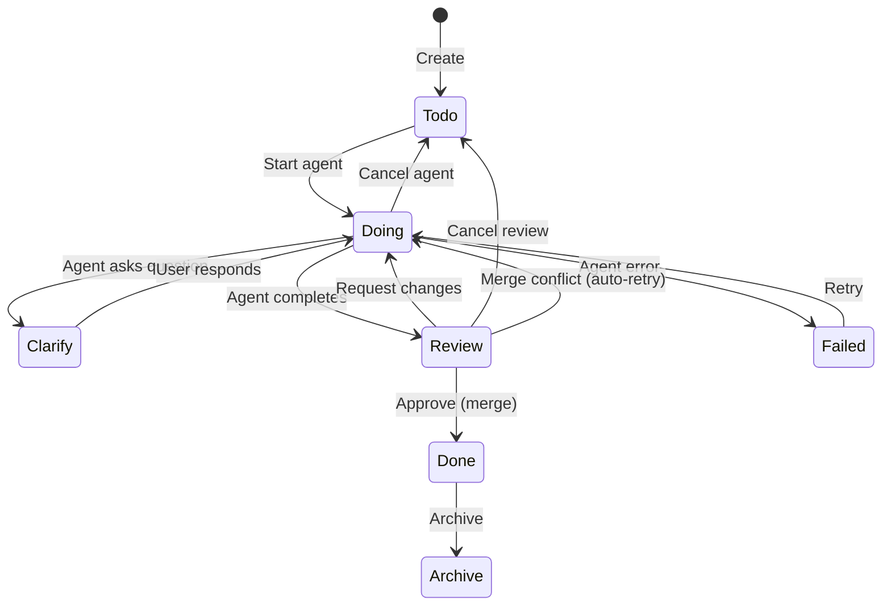
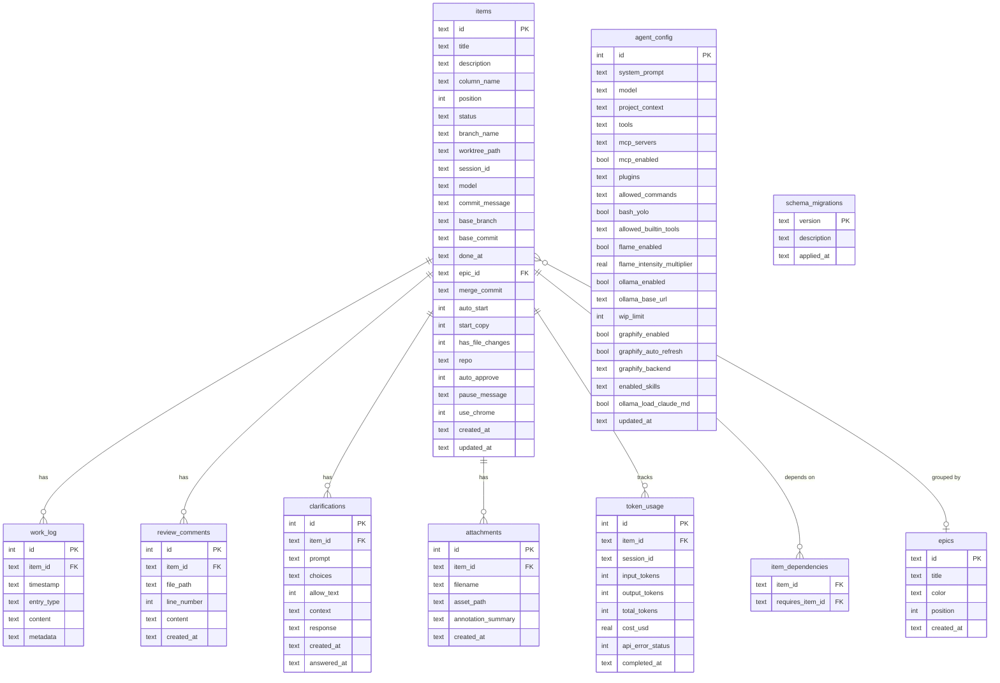

<a href="https://claude.ai"></a>



# Claude Agents Dashboard

A standalone scrum board that orchestrates Claude agents working on your project. Each board item becomes a task for an AI agent that works in its own git worktree, keeping changes isolated until you approve and merge them.

## Quick start

From your project repository:

```bash
path/to/claude-agents-dashboard/run.sh
```

Or pass the project path explicitly:

```bash
path/to/claude-agents-dashboard/run.sh /path/to/your/project
```

The server starts at `http://127.0.0.1:8000` (auto-increments ports 8000-8019 if busy). Open the dashboard in your browser — on macOS:

```bash
open http://127.0.0.1:8000
```

### Command-line options

```
run.sh [target] [options]

  target           Project directory, or a parent folder of sibling repos
                   (default: current directory)
  --host HOST      Bind address (default: 127.0.0.1). 0.0.0.0 accepts
                   connections from any interface — see Security below
  --port PORT      Fixed port instead of auto-selecting 8000-8019
  --experimental   Enable the Ollama and Kimi providers
  --ui-map         Enable PROJECT_MAP overlays (Cmd+Shift+M)
```

The target and the options can come in any order — `run.sh --port 8100 /path/to/project` and `run.sh /path/to/project --port 8100` are the same. `run.sh` no longer mistakes an option value for the target path.

### Make targets

A `Makefile` wraps the common commands — run `make` with no arguments for an interactive menu:

```bash
make start                  # run against the current directory
make start_at TARGET=/path  # run against another project
make test                   # full suite
make test_unit              # one tier (also test_smoke, test_integration, test_e2e)
make test_filter F=cancel   # pytest -k
make setup                  # create the venv and install dependencies
```

Your project must be a git repository, **or** a parent folder containing one or more sibling git repos (multi-repo workspace mode). Requires Python 3.12+.

### Multi-repo workspaces

Point `run.sh` at a folder that contains several sibling git repos, and the dashboard runs in **multi-repo mode**: each board item carries a `repo` field selecting which sibling repo it targets, and worktrees are created under the workspace-level `agents-lab/worktrees/` (named `<repo>-<item-id>`), branched from the chosen subrepo. Agents have read-only access to the other sibling repos for cross-repo context.

```bash
path/to/claude-agents-dashboard/run.sh /path/to/workspace-with-many-repos
```

### Running tests

```bash
./run-tests.sh
```

Pass extra args to pytest: `./run-tests.sh tests/smoke/ -v` or `./run-tests.sh -k "test_cancel"`. The suite includes 1338 tests across smoke, unit, and integration tiers (`run-tests.sh` creates the venv and installs both `requirements.txt` and `requirements-test.txt` on first run).

E2E tests run separately and **spawn real agents, which costs tokens**:

```bash
./run-e2e-tests.sh                 # all E2E tests
./run-e2e-tests.sh --verbose       # stream server and agent output
./run-e2e-tests.sh --model <id>    # override the model under test
```

They need **Node.js and npm** (the runner `npm install`s Playwright on demand) and operate on a scratch project, `./claude-agents-dashboard-e2e-test`, created next to the current directory. `E2E_RESET=yes|no|ask` controls whether that scratch project is reset between runs (it defaults to keeping it when stdin is not a TTY); `E2E_PORT` points the tests at an already-running server.

Coverage has its own runners: `./run-coverage.sh` (unit/integration/smoke, writes `htmlcov/`) and `./run-e2e-coverage.sh` (combined coverage across an E2E run). A bare `pytest` collects no coverage — `pytest.ini` sets no `--cov` and enforces no threshold.

## Try the demo

Want to see the dashboard build a real application from a single sentence? The [**kanban-demo**](https://github.com/epatel/kanban-demo) repo is a one-file starter that drives the whole pipeline end to end.

```bash
# 1. Clone the starter repo
git clone https://github.com/epatel/kanban-demo.git

# 2. Point the dashboard at it
path/to/claude-agents-dashboard/run.sh /path/to/kanban-demo

# 3. Open the board, create a Todo, and start it:
#    Lets have some fun. Read @START.md
```

That single Todo (`Lets have some fun. Read @START.md`) is all you provide. The repo ships with just a `.gitignore` and a [`START.md`](https://github.com/epatel/kanban-demo/blob/main/START.md) brief — the agent reads the brief, scaffolds the project (Makefile, virtualenv, `project-plan.md`), then **breaks the work into chained Todo items** that auto-start as their dependencies resolve. You watch the board fill itself in and build out the app, hands-off.

The brief asks for **"Doodle Together"** — a real-time multiplayer drawing app with a Python + WebSockets backend, accounts, a shared live canvas, chat, and a Pictionary game mode. A finished example of what the agents produce is live at **[ai.memention.net/kanban-demo](https://ai.memention.net/kanban-demo/)**: rooms you can create or join, strokes that sync live for everyone, a color/brush/clear toolbar, a Pictionary mode with a scoreboard, and a side chat panel.

This is a good first run for seeing the [task-breakdown, dependency, and auto-start](#features) features work together on a single prompt.

## How it works



1. **Create items** on the kanban board (Todo → Doing → Questions → Review → Done → Archive)
2. **Start an agent** on a Todo item — it gets its own git worktree and runs autonomously
3. **Watch progress** in real-time via the work log (thinking, tool use, messages)
4. **Review changes** — browse the diff, approve to merge into main, or request changes
5. **Agent remembers** — when you request changes, it resumes its session with full context

## Settings

The Settings dialog has eight tabs:

| Tab | Covers |
|---|---|
| General | Default model, WIP limit, allowed commands + Bash YOLO, optional built-in tools (Web Search / Web Fetch) |
| Prompts | System prompt and project context given to every agent |
| Ollama | Local-model provider: enable toggle, base URL, connection status, model discovery (only shown with `--experimental`) |
| MCP | External MCP servers handed to agents |
| Plugins | User-configured Claude Code plugins |
| Graphify | Knowledge-graph enable, auto-refresh, backend, build/upgrade controls |
| Skills | The Agent-Skills library: browse, discover, install, enable per project, remove |
| Appearance | Theme and the flame-effect controls |

## What it creates

An `agents-lab/` directory in your project:

```
your-project/agents-lab/
  dashboard.db        # SQLite database
  shortcuts.json      # Quick-launch bash commands
  assets/             # Uploaded images/attachments
  worktrees/          # Git worktrees for active agent tasks
```

In single-repo mode the dashboard adds `agents-lab/` to the project's `.gitignore` on first run and commits that change. In multi-repo mode nothing is added — the workspace root is not itself a git repo, and each sibling repo's git scope does not reach the workspace-level directory.

The SQLite database uses a versioned migration system to manage schema changes safely.

## Features

- **Kanban board** with drag-and-drop (smooth card spacing), create/edit/delete items
- **Save & Start** — create an item and immediately launch an agent in one click
- **Start Copy** — start a copy of a Todo item while keeping the original, useful for running task variations
- **Agent orchestration** via Claude Agent SDK — multiple agents can run simultaneously
- **Git worktrees** — each agent works in isolation, branched off main
- **Live work log** — streaming agent output via WebSocket (messages, thinking, tool use)
- **Review & merge** — tabbed dialog (Description, Result, Diff, Files, Work Log); approve or request changes
- **Clarification flow** — agents can ask the user questions mid-task via custom MCP tool; the optional `context` field on `ask_user` is rendered as a panel above the prompt so the user sees relevant background before answering
- **Todo creation** — agents can create new todo items while working, breaking down complex tasks into smaller actionable items; supports `requires` parameter to declare dependencies between items and `auto_start` to automatically launch agents when dependencies are resolved
- **Custom commit messages** — agents set meaningful commit messages via MCP tool, used when merging
- **Board introspection** — agents can view the current board state (all items by column) via the `view_board` MCP tool to understand project context
- **Cross-worktree peek** — agents running in parallel can see what the others are changing *before* it merges, via the read-only `peek_worktree` MCP tool: a summary of every active worktree with the files that collide with the caller's own flagged, one agent's full file list, or one file's diff. Cuts merge conflicts in fan-out runs
- **Tool access requests** — agents can request permission to use optional built-in tools (WebSearch, WebFetch) at runtime via the `request_tool_access` MCP tool with user approval prompt
- **Done column day grouping** — completed items grouped by day (Today, Yesterday, etc.) with collapsible sections, compact title lists, and bulk archive per day group
- **Stats dashboard** — real-time header bar showing total cost, token usage, active agents, and items completed today; auto-refreshes every 10 seconds and on WebSocket events
- **Cost & token tracking** — agent completion logs USD cost and token consumption (input/output/total) per task, persisted to a dedicated `token_usage` table
- **System notifications** — bell icon in header with badge counter; surfaces MCP server connection failures, agent errors, and warnings; dismiss individually or clear all
- **MCP status monitoring** — automatically checks MCP server status after agent session connect; failed/disconnected/needs-auth servers create system notifications
- **Retry with session resume** — retry resumes the agent's previous session via session_id, preserving conversation context; falls back to fresh start if no session available
- **Cancel & cancel review** — cancel a running agent or discard review changes, clean up worktree/branch
- **Annotation canvas** — drop images, scale/move them, draw arrows, circles, rectangles, and text; saved as PNG attachments
- **Attachments** — attach annotated screenshots and reference images to items
- **Per-item model selection** — choose a Claude model per item (falls back to global config; Claude Opus 5 is the default). The Claude **and** Kimi lists are fetched from a [published model feed](https://epatel.github.io/model-lists/models.json) at startup and refreshed every 6 hours, with bundled per-provider lists used offline. Ollama models are discovered separately from the local Ollama server
- **1M-context variants** — some models appear twice, e.g. `Claude Opus 5` and `Claude Opus 5 (1M)`. The `(1M)` entry carries a `[1m]` id suffix that opts the spawned `claude` CLI into the optional 1M-token context window at standard pricing. Only models that treat 1M as opt-in get a paired entry; models that always run at 1M (Fable 5, Sonnet 5) have a single entry, and models without 1M support have none
- **Auto-approve modes** — per-item setting to skip the manual review gate: OFF (lands in Review for a human), REVIEW (spawns a read-only review agent that auto-merges on approval or sends comments back to the original agent, capped at 3 round-trips), or DIRECT (auto-merge as soon as the agent finishes)
- **Knowledge graph (graphify)** — the dashboard owns a navigable AST + optional semantic graph of the target project (`graphify-out/`); when enabled in Settings ▸ Graphify, agents get a read-only `graph_query` MCP tool to orient before editing, and the graph auto-refreshes after a merge (free AST build); managed via `/api/graphify/*` with live build-progress over WebSocket
- **Skills library** — a dashboard-managed library of [Agent Skills](https://docs.claude.com/en/docs/claude-code/skills): browse Anthropic's public skills repo, or install any skill from a GitHub repo/path/URL via Settings ▸ Skills. Installed skills are stored in a gitignored `skill-library/` (each wrapped as a one-skill plugin) and enabled **per project**; enabled skills are delivered to agents through the SDK `plugins=` option so they load regardless of git/worktree/`setting_sources`. Managed via `/api/skills/*`
- **Per-task Chrome integration** — items can opt into a Chrome browser session for the agent (`use_chrome`), enabling browser-driven work
- **Transient API-error handling** — agent completions classify and persist `api_error_status` on `token_usage`, surfacing transient Claude API failures (e.g. overload) distinctly from real agent errors
- **Multi-repo workspaces** — point the dashboard at a folder containing sibling git repos and each item picks one of them via a `repo` field; worktrees are created inside the chosen subrepo and agents get read-only access to the other sibling repos for cross-repo context
- **WIP limit** — configurable cap on concurrent running agents; items started beyond the limit are queued and auto-started when a slot opens
- **Agent config** — set system prompt, model, project context, MCP servers, and plugins
- **MCP support** — connect external tools and data sources via Model Context Protocol; includes an example stdio server (`examples/mini-mcp/`) for reference
- **Plugin support** — load local Claude Code plugins via directory paths. Anything under the dashboard's own `plugins/` directory is auto-discovered and delivered **always-on** to every agent; it currently ships `board-workflows` (the `brainstorm`, `plan-tasks` and `debug` skills that shape how agents handle those kinds of task)
- **Merge conflict auto-resolution** — on merge conflict, captures the agent's diff, resets the worktree to the latest base branch, and restarts the agent with the previous diff as context for automated recovery
- **Item cleanup** — deleting an item stops running agents, removes worktrees and branches, and cleans up attachment files
- **WebSocket reconnection** — automatic reconnection with exponential backoff, visibility-aware, manual reconnect via status indicator
- **WebSocket rate limiting** — per-IP connection limits (5 concurrent, 10 per 60s window) prevent resource exhaustion
- **Stats caching** — server-side stats caching with 30s TTL, invalidated on mutations for fresh data
- **Git operation timeouts** — configurable timeouts for git operations (5min), merges (10min), and HTTP requests (11min)
- **File browser** — browse the target project's source code in a full-featured dialog with directory tree, tabbed file viewer, Prism.js syntax highlighting, rendered markdown with mermaid diagrams, inline image previews, 3D model previews (`.stl`/`.obj` via three.js), `.zip` archive content listing, secret file hiding, file filter, keyboard navigation, and breadcrumb navigation
- **Allowed commands** — configure which shell commands agents can run (e.g., flutter, npm, cargo); agents can request access at runtime via MCP tool with user approval prompt
- **Bash YOLO mode** — optional mode that grants agents unrestricted bash access (configurable per project via agent config)
- **Base branch tracking** — worktrees record which branch they were created from for reliable merge targeting
- **Base commit pinning** — worktrees record the exact commit SHA at creation time, ensuring diffs remain stable even when the base branch moves forward (e.g., after merging other items)
- **Merge commit tracking** — stores the merge commit SHA when items are approved, enabling traceability from board items to git history
- **Dirty repo detection** — blocks merge if your working tree has uncommitted changes overlapping with the agent's files; moves the item to the Questions column with guidance to commit or stash first
- **Epic grouping** — organize items into epics with a collapsible progress panel above the board, colored badges on cards, Todo column grouping by epic, board filtering by epic, inline epic creation in the item dialog, and agent integration via MCP tools; 8 preset colors with light/dark theme variants
- **Auto-start pipelines** — items with `auto_start` enabled automatically launch an agent when all their dependency items are completed, enabling pipeline-style workflows
- **Search** — spotlight-style search dialog (toolbar button) to find items across all columns and search work log entries
- **Archive cleanup** — archiving items automatically cleans up their worktree and session resources
- **Shortcut creation** — agents can add quick-launch bash command shortcuts to the board via the `create_shortcut` MCP tool (e.g., test runners, build commands)
- **Shortcuts bar** — quick-launch bash commands from a bar at the bottom of the board; commands run as subprocesses with streaming output, stop (preserves output log), reset, auto-reset mode, and cleanup
- **Worktree file browser** — browse an agent's worktree files during review via a tree view within the review dialog
- **Retry merge** — re-attempt a failed merge without restarting the agent
- **File change detection** — when an agent completes, the system detects whether any files were changed; review cards show "Done" (no changes) or "Approve & Merge" (has changes) accordingly
- **Standalone item detail page** — each item has a shareable URL; Done detail dialog includes a copy-link button for sharing
- **Animated flame background** — optional animated flame effect behind board columns with activity-driven intensity; configurable via agent config (flame_enabled setting)
- **Ollama provider** (experimental) — run agents against local Ollama models via Claude Code's env override mechanism; dynamic model discovery, connection status indicator, provider badges on cards; enable with `--experimental` flag
- **Kimi provider** (experimental) — run agents on Kimi models (`kimi-code/k3`, `k3-256k`, `kimi-for-coding`, `kimi-for-coding-highspeed`) via the Kimi Agent SDK's ACP client (`kimi acp` subprocess); full feature parity: streaming, pause/resume, commit messages, clarifications, board tools (stdio MCP proxy), permission hooks; auth via one-time `kimi login`; enable with `--experimental` flag. Note the **weaker worktree boundary**: out-of-worktree paths are denied on the tool calls kimi raises a permission request for and logged on the rest — see [`CARDS/KIMI_PROVIDER.md`](AGENT_FILES/CARDS/KIMI_PROVIDER.md)
- **Light/dark mode** — respects system preference with manual toggle

## Architecture



### Technology stack

- **Backend**: Python, FastAPI, uvicorn, aiosqlite, 7-service architecture (Workflow, Database, Notification, Git, Session, Graph, Skills) on top of an explicit `ItemState` finite state machine (`src/domain/`) and item/epic repositories (`src/repositories/`), ~11,700 lines across 43 source files (excluding migrations)
- **Frontend**: Jinja2 templates, vanilla HTML/CSS/JS, WebSocket, modular dialog system (12 specialized modules), Prism.js syntax highlighting, mermaid diagram rendering, ~9,600 lines JS + ~3,850 lines CSS
- **Agent**: Claude Agent SDK (`claude-agent-sdk` >=0.2.165), models: Claude Opus 5 (default) plus the current Claude list from the published model feed, 12 built-in MCP tools across 10 servers (incl. read-only `graph_query` and `peek_worktree`); installable Agent Skills delivered via `plugins=`; optional Ollama and Kimi providers (experimental — Kimi runs on a separate runtime: `kimi-agent-sdk` ACP client driving the `kimi` CLI)
- **Database**: SQLite with 31 versioned migrations (auto-runs on startup)
- **Security**: Localhost by default (`--host 0.0.0.0` opts out and prints a warning), no authentication, path traversal protection, path guard hook (Claude runtime; the Kimi runtime applies the same `PathScope` predicate in its ACP permission handler), WebSocket rate limiting, git operation timeouts, CORS limited to localhost ports 8000–8019, security response headers

### Item lifecycle



## Requirements

- **Python 3.12+** (tested on macOS, Linux, and Windows with WSL)
- **Git** (any modern version)
- **Claude Code** - must be installed and logged in (`claude` CLI). The dashboard uses the Claude Agent SDK which authenticates through your Claude Code session — no API key needed
- **Internet connection** - for Claude API calls, the published model feed, and the CDN-hosted frontend libraries (Prism, marked, DOMPurify, mermaid, three.js); the UI degrades without the CDN
- **Node.js and npm** - only for the E2E test suite
- **GitHub access on install** - `requirements.txt` pulls `kimi-agent-sdk` from a git fork (the ACP client is not on PyPI), so `run.sh` needs to reach GitHub even if you never use the Kimi provider
- **`kimi` CLI >= 0.27.0 on PATH** - only for the experimental Kimi provider, plus a one-time `kimi login`

## Example use cases

- **Bug fixes**: Create a "Fix login error" item, let an agent analyze logs and implement a solution
- **Feature development**: "Add dark mode toggle" → agent updates CSS, templates, and JavaScript
- **Code refactoring**: "Extract payment logic to service" → agent reorganizes code while preserving functionality
- **Documentation**: "Update API docs" → agent reviews code and updates documentation files
- **Testing**: "Add unit tests for user service" → agent analyzes code and writes comprehensive tests
- **Task breakdown**: Agents can create follow-up todos like "Add integration tests" or "Update documentation" as they discover related work

## Database Management

The project uses a SQLite database with a versioned migration system for safe schema updates. The schema starts with `001_initial_schema.py` that creates all core tables, with subsequent migrations (002–031) adding columns and tables incrementally. Migrations run automatically on startup.

### Database schema



### Migration Commands

From the project root directory:

```bash
# Show current migration status
python -m src.manage status

# Run all pending migrations (also runs automatically on startup)
python -m src.manage migrate

# Migrate to a specific version
python -m src.manage migrate --to 002

# Rollback to a specific version
python -m src.manage rollback 001

# Initialize a fresh database
python -m src.manage init
```

### Database Location

The SQLite database is created at `your-project/agents-lab/dashboard.db`. You can specify a different location:

```bash
python -m src.manage --db-path /path/to/custom/database.db status
```

### Creating Migrations

1. Copy the migration template: `src/migrations/versions/000_template.py.example`
2. Rename to format: `XXX_description.py` (e.g., `002_add_user_settings.py`)
3. Update version number and description
4. Implement `up()` method (apply changes) and `down()` method (rollback changes)
5. Test thoroughly before deploying

## API Reference

### REST Endpoints

| Method | Path | Description |
|--------|------|-------------|
| `GET` | `/` | Board page (HTML) |
| `GET` | `/api/items` | List all items |
| `POST` | `/api/items` | Create item |
| `PATCH` | `/api/items/{id}` | Update item |
| `DELETE` | `/api/items/{id}` | Delete item (full cleanup) |
| `POST` | `/api/items/{id}/move` | Drag-drop reposition |
| `POST` | `/api/items/{id}/start` | Start agent |
| `POST` | `/api/items/{id}/cancel` | Cancel agent |
| `POST` | `/api/items/{id}/retry` | Retry failed agent |
| `POST` | `/api/items/{id}/approve` | Approve & merge |
| `POST` | `/api/items/{id}/request-changes` | Send feedback to agent |
| `POST` | `/api/items/{id}/pause` | Pause running agent |
| `POST` | `/api/items/{id}/resume` | Resume paused agent |
| `POST` | `/api/items/{id}/cancel-review` | Discard review changes |
| `POST` | `/api/items/{id}/retry-merge` | Retry a failed merge |
| `POST` | `/api/items/{id}/start-copy` | Start a copy of a todo item |
| `POST` | `/api/items/{id}/approve-command` | Approve/deny agent command request |
| `GET` | `/api/items/{id}/dependencies` | Get item dependencies |
| `PUT` | `/api/items/{id}/dependencies` | Set item dependencies |
| `GET` | `/api/items/{id}/is-blocked` | Check if item is blocked |
| `GET` | `/api/items/blocked-status` | Blocked status for all items |
| `POST` | `/api/items/archive-by-date` | Bulk archive items by date |
| `POST` | `/api/items/archive-by-epic` | Bulk archive done items by epic |
| `POST` | `/api/items/delete-by-date` | Bulk delete items by date |
| `POST` | `/api/items/delete-by-epic` | Bulk delete items by epic |
| `GET` | `/api/items/{id}/worktree/tree` | Browse worktree directory tree |
| `GET` | `/api/items/{id}/worktree/content` | Read file from worktree |
| `GET` | `/api/items/{id}/log` | Work log entries |
| `GET` | `/api/items/{id}/diff` | Diff + changed files |
| `GET` | `/api/items/{id}/files/{path}` | File content at branch |
| `GET` | `/api/items/{id}/clarification` | Pending clarification |
| `POST` | `/api/items/{id}/clarify` | Submit clarification response |
| `GET/POST` | `/api/items/{id}/attachments` | List/upload attachments |
| `DELETE` | `/api/attachments/{id}` | Delete attachment |
| `GET` | `/api/assets/{filename}` | Serve uploaded files |
| `GET/PUT` | `/api/config` | Agent configuration |
| `GET` | `/api/notifications` | List system notifications |
| `DELETE` | `/api/notifications/{id}` | Dismiss a notification |
| `DELETE` | `/api/notifications` | Clear all notifications |
| `GET` | `/api/stats` | Usage & activity stats |
| `GET` | `/api/epics` | List all epics with progress stats |
| `POST` | `/api/epics` | Create epic |
| `PUT` | `/api/epics/{id}` | Update epic |
| `DELETE` | `/api/epics/{id}` | Delete epic (nullifies items' epic_id) |
| `GET` | `/api/config/available-tools` | List available optional tools |
| `GET` | `/api/search/worklog` | Search work log entries |
| `GET` | `/api/epics/colors` | Available epic colors |
| `GET` | `/api/shortcuts` | List shortcuts |
| `POST` | `/api/shortcuts` | Create shortcut |
| `DELETE` | `/api/shortcuts/{id}` | Delete shortcut |
| `POST` | `/api/shortcuts/{id}/run` | Run shortcut command |
| `POST` | `/api/shortcuts/{id}/stop` | Stop running shortcut (preserves output) |
| `GET` | `/api/shortcuts/{id}/output` | Get shortcut output |
| `POST` | `/api/shortcuts/{id}/reset` | Reset shortcut |
| `GET` | `/api/websocket/stats` | WebSocket connection stats |
| `GET` | `/api/ollama/models` | Discover local Ollama models (experimental; `?force=true` busts cache) |
| `POST` | `/api/items/{id}/agent-todos` | Create a todo on behalf of a running agent (full create_todo semantics: requires/autostart) |
| `GET` | `/api/graphify/status` | Knowledge-graph status: installed/latest version, build-in-progress, graph stats |
| `POST` | `/api/graphify/build` | Build the graph (`semantic` flag for the LLM layer) |
| `POST` | `/api/graphify/install` | Upgrade the graphify package in the dashboard venv |
| `GET` | `/api/graphify/query` | Query the graph (`q=...`) |
| `GET` | `/api/skills` | List installed library skills with per-project enabled flags |
| `GET` | `/api/skills/browse` | List installable skills from a public source (cached) |
| `POST` | `/api/skills/discover` | Find every skill (folder with a `SKILL.md`) in a repo/path |
| `POST` | `/api/skills/install` | Install a skill from a GitHub repo/path/URL spec |
| `POST` | `/api/skills/{name}/enabled` | Enable/disable an installed skill for this project |
| `DELETE` | `/api/skills/{name}` | Remove a skill from the library |
| `GET` | `/api/files/tree` | Directory tree (lazy, depth-limited) |
| `GET` | `/api/files/content` | File content (text, image, binary) |
| `GET` | `/api/workspace` | Workspace info (single- vs multi-repo, sibling repos) |
| `GET` | `/api/items/{id}` | Standalone HTML detail page for one item (what the copy-link button yields) |
| `GET` | `/api/items/{id}/peek` | What other running agents changed in their worktrees (backs `peek_worktree` for Kimi) |
| `GET` | `/api/yolo-items` | Items currently running with Bash YOLO mode on |
| `GET` | `/api/auto-reviewing-items` | Items currently under an auto-review pass |
| `POST` | `/api/cleanup/worktree/{id}` | Remove a stale worktree |
| `PUT` | `/api/shortcuts/{id}` | Update a shortcut |
| `POST` | `/api/shutdown` | Shut the server down (used by the E2E coverage runner) |
| `WebSocket` | `/ws` | Real-time event stream |

### WebSocket Events

| Event | Direction | Description |
|-------|-----------|-------------|
| `item_created` | Server → Client | New item added |
| `item_updated` | Server → Client | Item fields changed |
| `item_moved` | Server → Client | Item repositioned |
| `item_deleted` | Server → Client | Item removed |
| `agent_log` | Server → Client | Agent activity (message, tool use, thinking) |
| `clarification_requested` | Server → Client | Agent needs user input |
| `notification_added` | Server → Client | System notification (MCP error, agent failure) |
| `epic_created` | Server → Client | New epic added |
| `epic_updated` | Server → Client | Epic fields changed |
| `epic_deleted` | Server → Client | Epic removed |
| `graph_build_progress` | Server → Client | Graphify build phase updates |
| `graph_ready` | Server → Client | Graphify build finished (or failed) |
| `permission_requested` | Server → Client | Agent asked to run a command outside its allowlist |
| `tool_permission_requested` | Server → Client | Agent asked for an optional built-in tool |
| `merge_blocked` | Server → Client | Merge blocked; asking the user how to proceed |
| `dependencies_changed` | Server → Client | An item's dependency set was edited |
| `dependencies_resolved` | Server → Client | An item's blockers all completed |
| `blocked_status_changed` | Server → Client | Blocked/unblocked state changed for one or more items |
| `shortcut_created` | Server → Client | A shortcut was created (incl. by an agent) |
| `yolo_mode_changed` | Server → Client | Bash YOLO mode toggled for an item |
| `auto_review_changed` | Server → Client | Auto-review started or finished for an item |
| `ping` | Server → Client | Heartbeat keeping the connection alive |

## Troubleshooting

### Common issues

**Port already in use**: The server auto-increments ports (8000 → 8001 → 8002...), but if all ports in range are busy, restart the conflicting services or wait a moment.

**Agent fails to start**: Ensure Claude Code is installed and you're logged in:
```bash
claude --version  # Should show version
claude            # Opens interactive mode — log in if prompted
```

**Git worktree errors**: If you see git worktree issues, check that your project has at least one commit on the main/master branch:
```bash
git log --oneline -1  # Should show at least one commit
```

**Permission denied**: On some systems, you may need to make `run.sh` executable:
```bash
chmod +x /path/to/claude-agents-dashboard/run.sh
```

**Python version**: Verify you have Python 3.12+:
```bash
python3 --version  # Should show 3.12.0 or higher
```

### Getting help

If agents seem stuck or unresponsive, check the work log in the UI for error messages. You can always stop a running agent and restart it, or move items back to "Todo" to try a different approach.

## macOS app

A native macOS wrapper app is available under [Releases](../../releases) as a prebuilt `.app` bundle. It provides a desktop interface for managing multiple projects without using the terminal:

- **Add projects** via a file browser with smart suggestions (scans ~/Developer, ~/Development, etc.)
- **Start/stop dashboards** per project with real-time startup logs
- **Tabbed interface** — switch between running dashboards, each rendered in an embedded WebView
- **Auto-install** — on first run, clones the server repo to `~/.agents-dashboard/`, creates a Python venv, and installs dependencies
- **Update detection** — checks for upstream changes and prompts to pull

Requires macOS 14+. Source code is in `wrappers/macos/`.

## Uninstalling / cleaning up leftover data

The dashboard and the macOS wrapper scatter data in a few places outside the repo you cloned. To remove everything:

**Per-project data** — created in every project (or workspace root) you pointed the dashboard at:

```bash
# Run from each target project / workspace you used
rm -rf agents-lab/        # SQLite DB, uploaded assets, agent worktrees
rm -rf graphify-out/      # codebase knowledge graph (only if graphify was used)
```

`agents-lab/` holds active git worktrees. If any agents are still running, stop the dashboard first. To find every copy:

```bash
find ~ -type d -name agents-lab 2>/dev/null
```

**macOS wrapper data** — created by the prebuilt `.app` (not by `run.sh`):

```bash
rm -rf ~/.agents-dashboard                                      # auto-cloned server repo + Python venv
rm -f  ~/Library/Preferences/com.agentsdashboard.macos.plist    # saved project list (UserDefaults)
rm -rf "/Applications/Agents Dashboard.app"                      # the app bundle itself
```

After editing the preferences plist you may need to run `defaults delete com.agentsdashboard.macos` (or log out) to clear the cached `cfprefsd` copy.

> Nothing above touches the target project's own source — only the dashboard's generated data. The Claude CLI (`~/.claude/`) is shared with Claude Code and is **not** removed by uninstalling the dashboard.

## Multiple projects

Each project gets its own server instance. Run `run.sh` from different repos — ports auto-increment (8000, 8001, 8002, ...)

## Agent documentation

The `AGENT_FILES/` directory contains supplementary documentation for agents working on this project. The living docs are organized as routing-manifest **cards** in `AGENT_FILES/CARDS/` (start at [`CARDS/README.md`](AGENT_FILES/CARDS/README.md) and load only the cards whose **Load when** matches your task):

- [`CARDS/ARCHITECTURE.md`](AGENT_FILES/CARDS/ARCHITECTURE.md) — subsystem tour: services, web layer, agent runtime, repositories, frontend
- [`CARDS/CONVENTIONS.md`](AGENT_FILES/CARDS/CONVENTIONS.md) — naming, file organization, type-hint style, error shapes per layer, async / data-layer / frontend conventions
- [`CARDS/PROJECT_MAP.md`](AGENT_FILES/CARDS/PROJECT_MAP.md) — line-numbered entry points for named flows (`flow.merge`, `flow.clarify`, `flow.wip-queue`, …) and the `data-map-name` UI vocabulary
- [`CARDS/PROJECT_MAP_STRATEGY.md`](AGENT_FILES/CARDS/PROJECT_MAP_STRATEGY.md) — strategy doc for the project-map vocabulary and the live `Cmd+Shift+M` overlay
- [`CARDS/DATABASE.md`](AGENT_FILES/CARDS/DATABASE.md) — migration CLI, whitelist requirements, schema inspection
- [`CARDS/TESTING.md`](AGENT_FILES/CARDS/TESTING.md) — test layout (unit / integration / smoke / e2e) and per-suite conventions
- [`CARDS/COMMIT_POLICY.md`](AGENT_FILES/CARDS/COMMIT_POLICY.md) — commit policies (e.g. excluding annotation images)
- [`CARDS/OLLAMA_PROVIDER.md`](AGENT_FILES/CARDS/OLLAMA_PROVIDER.md) — Ollama as a local model provider via Claude Agent SDK + dashboard wiring
- [`CARDS/KIMI_PROVIDER.md`](AGENT_FILES/CARDS/KIMI_PROVIDER.md) — the Kimi runtime (experimental): ACP transport, board-tools MCP proxy, text protocols, permission trust model, worktree confinement and its residual gap
- [`CARDS/GRAPHIFY.md`](AGENT_FILES/CARDS/GRAPHIFY.md) — using and maintaining the codebase knowledge graph (`graphify-out/`)
- [`CARDS/SKILLS.md`](AGENT_FILES/CARDS/SKILLS.md) — the Agent-Skills library: install/enable skills and how enabled ones reach agents via `plugins=`
- [`CARDS/DEMO.md`](AGENT_FILES/CARDS/DEMO.md) — the one-prompt `kanban-demo` walkthrough, for demoing the dashboard end to end

One living reference sits outside `CARDS/`: [`docs/item-states.md`](docs/item-states.md) — the 13 `ItemState` values, their `(column_name, status)` encoding, and the transition diagram.

Point-in-time snapshots (**not maintained**) sit in the AGENT_FILES root: `ASSESSMENT_CODE.md` (module-by-module quality ratings), `AUDIT.md` (security audit, rev 13 — 17 findings, 9 of 10 actionable remediated and Kimi worktree confinement under `--experimental` mitigated; the open one is unvalidated skill-install paths), and dated decision/eval records (`EVAL_*`, `PLAN_*`, `SDK_BUMP_*`).

## License

[MIT](LICENSE)
