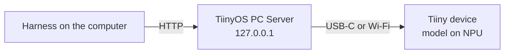

# Adding Tiiny support to an agent harness

Instructions for connecting a coding agent or LLM harness to a **Tiiny** device. The device runs models locally and exposes them through Anthropic-, OpenAI- and Ollama-compatible APIs. You can hand this file to a developer or to an AI coding agent as the spec.

Sources: Tiiny Help → *Claude Code* and *API Access* (https://help.tiiny.ai/#/api), plus checks run against a live device on 2026-11-06.

---

## 1. How the connection works



- The API hostnames (`*.api.tiiny`) resolve to **127.0.0.1**. The **TiinyOS PC Server** (`tiiny_svr`), installed with the TiinyOS desktop app, receives the requests there and forwards them to the device.
- So the harness must run **on the same computer as TiinyOS**, and TiinyOS must be running and connected to the device.
- A harness inside Docker, WSL, a VM or on another machine cannot resolve these names, so you have to route that traffic yourself (see §7).
- These are plain `http://` URLs with no TLS. Do not force `https://`.

## 2. Endpoints

| API format | Base URL | Model types |
|---|---|---|
| **Anthropic** (Messages API) | `http://anthropic.api.tiiny` | Text generation |
| **OpenAI-compatible** | `http://openai.api.tiiny/v1` | Text, embedding, rerank, image generation, ASR, TTS |
| **Ollama** | `http://ollama.api.tiiny` | Text, embedding |

Choose the format your harness already speaks natively, and don't mix paths across formats. Tiiny warns against using lookalike endpoints that haven't been tested.

Verified on 2026-11-06: `POST http://anthropic.api.tiiny/v1/messages` and `GET http://openai.api.tiiny/v1/models` both answer `401` when called without a key, so the endpoints are live and require authentication.

## 3. Credentials and model selection

| Value | Where the user finds it |
|---|---|
| Base URL | TiinyOS → **Settings → API Key** |
| API key | TiinyOS → **Settings → API Key** (one key works for all three formats) |
| Model ID | **Model Store → Model Details**, or right-click the model in the model panel |

- **Use the exact Model ID**, not the display name; the two often differ.
- **`default`** is a valid model ID. It routes to whatever model is currently loaded in TiinyOS, so the user can switch models without changing the harness config. Use it as the harness default.
- Send the key as a **Bearer token** (`Authorization: Bearer <key>`). This is how Claude Code authenticates to Tiiny through `ANTHROPIC_AUTH_TOKEN`. Whether the Anthropic-style `x-api-key` header also works has **not** been verified, so don't depend on it.
- Never log, screenshot or commit the key. Read it from an environment variable or the OS keychain.

## 4. Tool use (required for agent harnesses)

- An agent that edits files, runs commands or performs multi-step tasks needs a model **marked "Tool Use"** in TiinyOS. Other models can chat but can't call tools.
- If the model prints tool-call JSON as plain text, tool use is **not** working.
- The Anthropic endpoint supports **text generation only**. Don't send images or other modalities to it. For other types, use the OpenAI-compatible endpoint.

## 5. Implementation checklist for the harness

1. **Add a provider entry**, e.g. `tiiny`, with:
   - `base_url`: defaults to `http://anthropic.api.tiiny` for Anthropic-protocol harnesses, or `http://openai.api.tiiny/v1` for OpenAI-protocol ones
   - `api_key`: from env, e.g. `TIINY_API_KEY`
   - `model`: defaults to `default`
2. **Map every model tier to the same ID.** A harness with separate "large / medium / small" or "opus / sonnet / haiku" slots should set them all to the Tiiny model ID, because the device serves one loaded model.
3. **Disable features the local model can't provide.** Gate prompt caching, extended thinking, vision inputs, server-side tools (web search, code execution), batch APIs and token counting behind capability checks, or turn them off for this provider.
4. **Allow longer timeouts.** Local NPU inference and the first request after a model load can be slow. Use a request timeout of at least 120 s and stream responses where the harness supports it.
5. **Handle errors with clear messages:**
   - `401` → API key missing or wrong (re-copy it from TiinyOS, strip quotes and whitespace)
   - `404` → wrong model ID, or no model loaded when using `default`
   - connection refused / DNS failure → TiinyOS not running, or the harness isn't on the same machine
   - `502 Bad Gateway` → device reachable but its services are still starting (common for a few minutes after boot); retry with backoff
6. **Offer a connection test** that sends one short message and shows the reply, then a separate optional tool-use test (§6).

## 6. Acceptance tests

Run these in an empty temporary folder:

1. **Text:** send "Reply with the word OK". Expect a short text reply, and TiinyOS should show model activity.
2. **Tool use:** ask the agent to create `hello.txt` containing `hi`, then read it back. Pass = the file exists on disk with that content. Printed JSON or a printed shell command doesn't count.
3. **Errors:** a wrong key gives a clear 401 message, a wrong model gives a clear 404 message, and quitting TiinyOS gives a clear "Tiiny not reachable" message.

## 7. Reference configurations

### Claude Code (official Tiiny instructions)

Environment variables, for example in a shell function so normal `claude` sessions keep using Anthropic:

```bash
claude-tiiny() {
  ANTHROPIC_BASE_URL="http://anthropic.api.tiiny" \
  ANTHROPIC_AUTH_TOKEN="$TIINY_API_KEY" \
  ANTHROPIC_MODEL="default" \
  ANTHROPIC_DEFAULT_OPUS_MODEL="default" \
  ANTHROPIC_DEFAULT_SONNET_MODEL="default" \
  ANTHROPIC_DEFAULT_HAIKU_MODEL="default" \
  claude "$@"
}
```

Alternatively, put the same keys in the `env` object of `~/.claude/settings.json`. That applies to **every** Claude Code session.

### Generic OpenAI-compatible harness

```text
base_url = http://openai.api.tiiny/v1
api_key  = $TIINY_API_KEY
model    = default
```

### Generic Ollama-compatible harness

```text
host  = http://ollama.api.tiiny
model = default
```

The Tiiny docs don't say how this endpoint takes the API key. If you get `401`, send `Authorization: Bearer <key>`.

### Harness in Docker / WSL / VM / another computer

`*.api.tiiny` resolves only on the computer running TiinyOS. Either run the harness on that computer, or forward the traffic to it. If you forward it, send the original `Host` header (e.g. `anthropic.api.tiiny`), because the PC Server routes by hostname.

## 8. Tools for diagnosis

- Tiiny CLI: `~/.local/tiiny/bin/tiiny` (`tiiny scan`, `tiiny connect <ip>`, `tiiny login`, `tiiny status`, `tiiny ls`, `tiiny load <model>`)
- TiinyOS logs (macOS): `~/Library/Application Support/TiinyOS/logs/`
- PC Server logs (macOS): `/var/log/pcsvr/pcsvr.log/error.log`
- Developer docs and API reference: https://dev.tiiny.ai/
